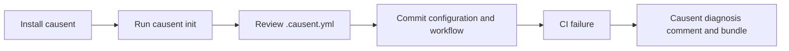

# Causent

Causent reproduces CI failures, collects evidence, and reports a deterministic
diagnosis. An optional model can suggest hypotheses from that evidence. Repair
is separate and verifies proposed changes in a disposable workspace.

Two entry points share one engine:

| | Provider | What it produces |
| --- | --- | --- |
| `repair` | optional, heuristic by default | hypotheses, experiments, candidate patches, verification reports |
| `diagnose` | none | deterministic classification, localization, replayable bundle |

`repair` runs the experimental patch workflow. `diagnose` performs reproduction,
classification, localization, and bundle creation without requiring a model.

Without `CAUSENT_MODEL_PROVIDER`, `repair` uses the built-in heuristic provider.
It is deterministic and limited; use a configured provider for model-backed
hypotheses.

## The repair loop

```
reproduce ──► evidence ──► hypotheses ──► experiment ──► patch ──► verify
 (command)     (bounded)    (model, >1)    (picks one)   (model)   (sandbox)
```

1. **Reproduce** — run the failing command; a failure that does not reproduce
   is not repaired.
2. **Collect evidence** — bounded excerpts of test output, source context, and
   `git diff`, each with a digest and provenance.
3. **Form hypotheses** — the model must return at least two competing
   hypotheses, each citing evidence IDs that actually exist. Anything else is
   rejected.
4. **Plan and run an experiment** — one command chosen to distinguish the
   hypotheses; its output updates which hypothesis survives.
5. **Generate a patch** — structured edits only, never a free-form diff blob.
   Unknown files and unanchored edits are rejected, and test files cannot be
   modified.
6. **Verify in a copy** — the diff is applied to a fresh copy of the repository,
   the original command runs, then up to three regression commands run. Only
   then is `verification_status` written.

## What a diagnosis observes

Every claim in the report is backed by an executed command, not by a model:

1. **Reproduce** — run the failing command N times (default 3) in a detached
   `git worktree`, never in your checkout, recording exit code, duration,
   timeout state, and a bounded output excerpt per attempt.
2. **Classify** deterministically — from exit codes and matched output signals,
   never from an LLM.
3. **Compare** — optionally re-run the same command on a base revision and
   compare outcomes to separate a regression from a pre-existing failure.
4. **Localize** — `git bisect` against a known-good ref, or a bounded walk back
   from HEAD, recording the first bad commit, likely files, and candidate commits.
5. **Bundle** — write a checksummed directory that can be replayed later.

If the command does not fail, or never executes, the diagnosis **refuses**
rather than inventing a result.

## Install and onboard

Users do not need to clone the Causent repository. A release contains the
Linux amd64 executable. Install it with:

```sh
mkdir -p "$HOME/.local/bin"
curl -fL https://github.com/causent/causent/releases/latest/download/causent_linux_amd64 \
  -o "$HOME/.local/bin/causent"
chmod +x "$HOME/.local/bin/causent"
export PATH="$HOME/.local/bin:$PATH"
causent version
```

Run this inside the repository that should use Causent:

```sh
cd /path/to/your/repository
causent init
```

The command detects the repository, shows its findings, and writes:

```text
.causent.yml
.github/workflows/causent.yml
```

Review `.causent.yml` and make sure `command` is the exact command used by the
repository's CI. Causent does not invent a command from a manifest alone.



### Version names

`v0.3.0` is a release tag. It identifies one published binary and is useful
when a user wants a fixed version.

`v1` is the major-version tag for the reusable GitHub Actions workflow. It
points to the current version 1 workflow so repositories can use:

```yaml
uses: causent/causent/.github/workflows/ci-diagnose.yml@v1
```

The release tag selects the binary installed by that workflow. The workflow
tag selects the workflow file. They are related, but they are not the same
thing.

To use a fixed workflow revision, replace `@v1` with a release tag such as
`@v0.3.0`.

### Build from source

Cloning the repository is only needed for Causent contributors or for users
who need to build it themselves:

```sh
git clone https://github.com/causent/causent.git
cd causent
go test ./...
```

**Repair a failure** (heuristic by default; set a provider for real hypotheses):

```sh
CAUSENT_GATEWAY_PROVIDER=ollama CAUSENT_GATEWAY_MODEL=qwen2.5:7b go run ./cmd/gateway &
CAUSENT_MODEL_PROVIDER=gateway CAUSENT_MODEL=qwen2.5:7b \
go run ./cmd/causent repair --repo . --command "python -m pytest -q test_bug.py" --budget 20
```

**Diagnose without a model** (deterministic, no network):

```sh
go run ./cmd/causent diagnose \
  --repo . \
  --command "go test ./..." \
  --attempts 3
```

Diagnosis output:

```
investigation: 20261101T120001Z-ab12cd34
repository: /path/to/repo
command: go test ./...
classification: real_regression
reproduced: 3/3 attempts failed
confidence: 0.82
head: c2a08af
last_known_good: unknown
first_known_bad: unknown
bisect: unavailable
changed_range: cf312ff..HEAD
likely_files:
  internal/diagnosis/replay.go
...
bundle: /path/to/repo/.causent/bundles/20261101T120001Z
replay: causent replay /path/to/repo/.causent/bundles/20261101T120001Z
```

## `repair`

```sh
CAUSENT_MODEL_PROVIDER=gateway \
CAUSENT_GATEWAY_ENDPOINT=http://127.0.0.1:8787 \
CAUSENT_MODEL=qwen2.5:7b \
go run ./cmd/causent repair --repo . --command "pytest -q test_bug.py" --budget 20
```

`repair` needs a provider, which it takes from `CAUSENT_MODEL_PROVIDER`:
`ollama`, `gateway` (aliases `hosted`, `byok`, `self_hosted`), or unset for the
built-in heuristic provider. It calls `Generate` for hypotheses and
`GeneratePatches` for candidates. `--budget` caps total investigation steps; the
run stops with `budget_exhausted` rather than looping.

It writes patches, but not to your checkout. Every candidate is applied to a
copy (`copyWorkspace`) that is deleted afterwards, and the patch records the
base revision it was generated against, refusing to verify if the repository
moved in the meantime.

### Verification is the only thing that counts

| `verification_status` | Meaning |
| --- | --- |
| `passed` | Original command exits 0 **and** every regression command passes |
| `failed` | Patch applied but the original failure still reproduces, or a regression broke |
| `inconclusive` | No baseline result to compare against |
| `error` | Execution failed — not a verdict about the patch |
| `cancelled` | Verification was cancelled before a result existed |

Patch status is separate and narrower: `does_not_apply`, `fails_original`,
`validated`. A patch reaches `validated` only through a `passed` verification.

The original and regression outputs are stored as artifacts and attached to the
verification report, so a maintainer can check the claim instead of trusting it.

### Known limits

- Regression command selection is **Python-only** right now: it walks the repo
  for `test_*.py` / `*_test.py`, skips the file already used as the failing
  command, and caps at three. For Go, Rust, or JavaScript there are no
  regression commands selected, so `passed` means "the original command exits 0"
  and nothing more.
- Experiments are model-proposed commands, not model-authored code.
- `root_cause_verified` is always false by design.

## Benchmarking the loop

`cmd/debug` runs the loop over a fixture corpus and records what happened:

```sh
go run ./cmd/debug evaluation run \
  --corpus benchmarks/corpus-v1.json \
  --repo "$PWD" \
  --db /tmp/causent-evaluation.db \
  --strategy direct_repair,evidence_guided \
  --timeout 5m --budget 20
```

The two strategies are the comparison this project is built to measure:
`direct_repair` goes straight from failure to patch, `evidence_guided` inserts
hypotheses and a discriminating experiment. Recorded trials live in
`benchmarks/results/`.

## `diagnose`

| Flag | Default | Meaning |
| --- | --- | --- |
| `--repo` | `.` | Repository to diagnose |
| `--command` | *(required)* | Command that reproduces the failure |
| `--attempts` | `3` | Reproduction runs; more attempts is how flakiness is proven |
| `--timeout` | `2m` | Timeout per attempt |
| `--base` | — | Base revision; compares base vs HEAD outcomes |
| `--good` | — | Known-good revision; switches localization to `git bisect` |
| `--max-commits` | `20` | Bound on the history walk when `--good` is absent |
| `--executor` | `local` | `local` or `docker` |
| `--image` | — | Required with `--executor docker` |
| `--bundle` | `<repo>/.causent/bundles/<timestamp>` | Bundle output directory |
| `--probe` | — | Extra diagnostic command, repeatable. Never treated as a fix |
| `--db` | `~/.causent/investigations.db` | SQLite events store |
| `--agent` | `false` | Ask the configured gateway model to read the collected evidence |
| `--json` | `false` | Machine-readable report |

### Classifications

| Value | Meaning |
| --- | --- |
| `real_regression` | Fails every attempt and matches no flake/environment signal |
| `flaky` | Both passing and failing runs of the identical command |
| `dependency_or_toolchain_drift` | Output matches missing-module / toolchain errors |
| `infrastructure_or_environment` | Output matches network, permission, disk, or Docker errors; also used when every attempt times out |
| `not_reproduced` | Command never failed — diagnosis refuses |
| `pre_existing_failure` | Assigned by `--base` comparison when base fails the same way |

Refusal is deliberate. When the command never fails, or never executes at all,
the report carries `refused: true` and a `refusal_reason`, the status is
`inconclusive`, and the CLI omits the replay hint. The bundle is still written —
it just records a refusal rather than a diagnosis.

`--base` adds a `comparison` line to the output:

```
comparison: base=db03196 (0/3 failed), head=c2a08af (3/3 failed), verdict=real_regression
```

That is the difference between "this PR broke it" and "this was already broken."

### Bundle layout

```
.causent/bundles/<timestamp>/
  manifest.json          schema version, bundle ID, embedded diagnosis
  report.json            full structured report
  environment.json       OS, arch, toolchain versions, HEAD commit, dirty flag
  baseline-results.json  per-attempt exit codes, durations, output excerpts
  bisect-results.json    localization outcome and candidate commits
  events.jsonl           ordered workflow state transitions
  evidence/              one file per evidence item
  replay.sh              standalone reproduction script
  checksums.txt          SHA-256 for every file above
```

`replay` refuses to run if checksums no longer match, so a bundle cannot be
silently edited before being trusted.

## `replay`

```sh
go run ./cmd/causent replay .causent/bundles/20261101T120001Z
```

Re-executes the recorded command and compares the observed classification
against the recorded one. It prints `conclusion: matched` or
`conclusion: MISMATCH` and exits non-zero on a mismatch. Use `--repo` to point
the bundle at a different checkout, and `--executor docker --image ...` to
replay in a container.

## Executors and safety

Local execution is the default. Docker is available for isolation:

```sh
go run ./cmd/causent diagnose \
  --repo . \
  --command "python -m pytest -q" \
  --executor docker \
  --image ghcr.io/causent/python:3.12
```

Docker runs use a read-only root filesystem, `--network none`, `--cap-drop ALL`,
`no-new-privileges`, a tmpfs `/tmp`, a non-root user matching your UID, and
bounded memory, CPU, process count, file descriptors, output size, and wall
clock. The workspace is the only read-write mount, because toolchains such as
`cargo` and `npm` write build output inside the tree.

### Execution policy

Local execution derives its allowlist from the command you pass, so any binary
works. Docker uses a fixed allowlist instead:

```
make  go  cargo  npm  yarn  python  python3
```

Under Docker, use a wrapper when the runner is not on that list — `python -m
pytest -q` rather than `pytest -q`, `npm test` rather than the underlying
runner. The error is explicit (`command "pytest" not allowed`) rather than a
silent skip.

Environment is filtered in both modes, and the two lists differ. Local keeps
`HOME`, `PATH`, `TMPDIR`, `TMP`, `TEMP`, `GOPATH`, `GOMODCACHE`, `GOROOT`,
`GOTOOLCHAIN`, `GOENV`, `LANG`, and `LC_ALL`. Docker keeps only `PATH`, `HOME`,
`USER`, `LANG`, `LC_ALL`, `TERM`, and `COLORTERM`. Secrets reach neither a
reproduced run nor a bundle. Output is capped at 64 KiB per attempt.

Containers are force-removed on timeout and cancellation.

## The inference gateway

Both the repair provider and the diagnose-side agent talk to the same local
OpenAI-compatible gateway, so provider formats stay out of the engine:

```sh
CAUSENT_GATEWAY_PROVIDER=ollama \
CAUSENT_GATEWAY_MODEL=qwen2.5:7b \
go run ./cmd/gateway
```

Point `repair` at it with `CAUSENT_MODEL_PROVIDER=gateway`. Point `diagnose` at it
with `--agent`:

```sh
CAUSENT_GATEWAY_ENDPOINT=http://127.0.0.1:8787 \
CAUSENT_GATEWAY_MODEL=qwen2.5:7b \
go run ./cmd/causent diagnose --repo . --command "go test ./..." --agent
```

`--agent` is separate from `repair`'s provider: it only asks a model to read
evidence the deterministic pass already collected. Without it, `diagnose` needs
no network at all. Model output is attached as a separate `agent` section and
never replaces the deterministic classification, and if the gateway is
unreachable the diagnosis still completes.

A model answer is a hypothesis. It cites evidence IDs, and it does not run
commands, edit files, or change the verdict.

The gateway normalizes Ollama, Gemini, and OpenAI-compatible endpoints behind
`/v1/chat/completions`, plus `/health`, `/v1/models`, and an SSE stream at
`/v1/investigations/{id}/events`.

The gateway has **no authentication or tenant authorization** and is a local
development component. It binds `127.0.0.1:8787` by default. Nothing prevents
you from binding it to another interface, so do not do that — event and
investigation IDs are the only thing protecting the stream.

## CI integration

Three workflows ship in `.github/workflows`:

- `ci.yml` — runs `go test ./...` on pushes to `main` and on pull requests.
- `ci-integration.yml` — triggered by `workflow_run` when another workflow
  completes, so it can diagnose a failed run once that run's data is final.
- `diagnosis.yml` — manual `workflow_dispatch` diagnosis with a supplied
  command, optional base ref, and optional Docker image.

The `workflow_run` design is deliberate: the diagnosing job needs
`actions: read` to fetch the failed run's logs, which is a permission the
failing job should not have to hold.

The reusable workflow reads the triggering run ID from the `workflow_run` event,
downloads failed job logs with the Actions CLI, checks out the recorded head
SHA, and runs the command from `.causent.yml` or the reusable-workflow input.
The command is never inferred from log text. If it is not configured, the run
fails with an explicit error rather than guessing. The workflow uploads the
diagnosis bundle and comments only when the run is associated with a pull
request. Fork runs are rejected by the repository ownership guard.

The workflow files are structurally tested in `validate_workflow_test.go`. A
live external-repository run still requires a published release and a test
repository with the required permissions.

## Environment variables

| Variable | Used by | Purpose |
| --- | --- | --- |
| `CAUSENT_EXECUTOR` | `diagnose`, `replay`, `repair` | Default executor (`local`/`docker`) |
| `CAUSENT_EXECUTOR_IMAGE` | `diagnose`, `replay`, `repair` | Default Docker image |
| `CAUSENT_DB` | `diagnose`, `repair` | SQLite event store path |
| `CAUSENT_MODEL_PROVIDER` | `repair` | `ollama`, `gateway`, or unset for heuristic |
| `CAUSENT_GATEWAY_ENDPOINT` | `repair` | Gateway URL for the `gateway` provider |
| `CAUSENT_OLLAMA_ENDPOINT` | `repair` | Ollama URL for the `ollama` provider |
| `CAUSENT_OLLAMA_MODEL` | `repair` | Ollama model name |
| `CAUSENT_GATEWAY_ENDPOINT` | `diagnose --agent` | Gateway base URL |
| `CAUSENT_GATEWAY_MODEL` | `diagnose --agent` | Model name |
| `CAUSENT_MODEL` | `diagnose --agent` | Fallback model name |
| `CAUSENT_GATEWAY_PROVIDER` | `cmd/gateway` | `ollama`, `gemini`, or `openai` |
| `CAUSENT_GATEWAY_ADDR` | `cmd/gateway` | Bind address, default `127.0.0.1:8787` |
| `CAUSENT_GATEWAY_API_KEY` | `cmd/gateway` | Upstream provider key |

## Project layout

| Path | Contents |
| --- | --- |
| `cmd/causent` | `diagnose`, `replay`, `repair` entry point |
| `cmd/gateway` | OpenAI-compatible inference gateway and SSE stream |
| `cmd/debug` | Development CLI: investigations, experiments, evaluation |
| `cmd/mcp-server` | MCP server exposing engine operations as tools |
| `internal/diagnosis` | Reproduction, classification, comparison, bundles |
| `internal/execution` | Local and Docker executors with policy limits |
| `internal/engine` | The repair loop: evidence, hypotheses, experiments, patch generation, sandbox verification |
| `internal/persistence` | SQLite investigations, events, patches |
| `internal/agent` | Gateway client for optional model analysis |
| `internal/evaluation` | Benchmark runner |
| `benchmarks` | Fixture corpus and recorded results |

## Current scope

The default diagnosis path is deterministic and does not require a model. The
repair path is experimental. Supported environments and known limitations are
listed in `docs/supported-environments.md` and `docs/installation.md`.

Run the test suite with model-provider variables unset:

```sh
go test ./...
```
