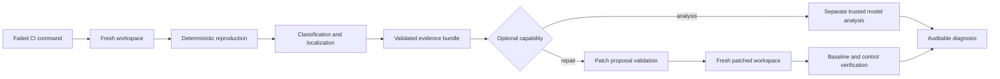

# Causent

Causent investigates failed CI runs and produces bounded, replayable,
evidence-first diagnosis reports.

It reproduces a failure, compares revisions when possible, localizes relevant
changes, records evidence, and classifies the result deterministically.
Optional model-assisted analysis and repair can assist after deterministic
diagnosis, but the model never becomes the source of truth for diagnosis or
verification.

## Project status

Causent is under active development.

The deterministic diagnosis workflow is the primary product. Repair is
experimental and opt-in. Causent does not silently modify a repository, create
pull requests, merge changes, or deploy anything.

## Requirements

Development requires:

- Go 1.26 or newer;
- Git;
- Python 3 for Python fixtures and integration tests;
- Docker only when using the Docker executor.

The default local executor is suitable for trusted local repositories. Use the
Docker executor for untrusted code when the host supports the required
container controls.

## Quick start

Run the complete test suite:

```sh
go test ./...
```

Run a deterministic diagnosis:

```sh
go run ./cmd/causent diagnose \
  --repo . \
  --command "go test ./..."
```

The diagnosis workflow does not require a model.

Run the explicit experimental repair workflow:

```sh
go run ./cmd/causent repair \
  --repo . \
  --command "go test ./..."
```

Use Docker for repair execution:

```sh
go run ./cmd/causent repair \
  --repo . \
  --command "go test ./..." \
  --executor docker \
  --image golang:1.26
```

The separate model proposal path is disabled by default. Enable it explicitly:

```sh
CAUSENT_MODEL_PROVIDER=gateway \
CAUSENT_GATEWAY_ENDPOINT=http://127.0.0.1:8787 \
CAUSENT_MODEL=your-model \
go run ./cmd/causent repair \
  --repo . \
  --command "go test ./..." \
  --model-proposals
```

The model proposal path requires a provider that implements the proposal
interface. It receives bounded diagnosis/evidence context only; it does not
receive a raw checkout or host credentials.

## Architecture



The model boundary is deliberately separate:

```text
deterministic diagnosis
    -> validated evidence bundle
    -> optional analysis or repair provider
    -> deterministic validation
    -> isolated execution only for repair
```

The model may propose a patch and hypotheses about that proposal. It cannot
execute commands, modify the workspace, assign diagnosis fields, or decide
whether verification succeeded.

## Diagnosis workflow

The normal workflow is:

1. Check out the target revision in an isolated Git worktree.
2. Run the configured command repeatedly.
3. Classify the failure as reproducible, flaky, resolved, or unavailable.
4. Compare the head with a base or known-good revision when configured.
5. Localize relevant files, stack frames, and commit history.
6. Build a bounded evidence bundle with stable IDs and digests.
7. Validate diagnosis claims against evidence references.
8. Persist the report, events, artifacts, and bundle checksums.

Diagnosis evidence is not the same as proof of root cause. Localization and
classification are reported with their uncertainty and limitations.

Supported environment adapters currently include Go, Node.js, Python, Rust,
and Bazel. Repository-specific commands should still be reviewed explicitly.

## Optional model-assisted analysis

Causent has three independent capabilities:

1. Deterministic diagnosis — enabled by default.
2. Model-assisted analysis — optional evidence review after diagnosis.
3. Model-generated patch proposal and verification — separately optional.

The normal GitHub Actions workflow runs deterministic diagnosis only. It does
not call a model, require gateway credentials, or expose secrets to repository
code.

For the reusable workflow, model analysis is intended to be selected
explicitly:

```yaml
jobs:
  diagnose:
    uses: causent/causent/.github/workflows/ci-diagnose.yml@v1
    with:
      agent: true
    secrets:
      CAUSENT_GATEWAY_ENDPOINT: ${{ secrets.CAUSENT_GATEWAY_ENDPOINT }}
      CAUSENT_GATEWAY_MODEL: ${{ secrets.CAUSENT_GATEWAY_MODEL }}
```

The provider endpoint and model must both be configured when `agent: true`.
Missing configuration is an explicit error; Causent does not silently use a
local fallback or pretend that model analysis succeeded.

The intended Actions flow is:

```text
CI failure
  -> deterministic diagnosis job
  -> bounded diagnosis artifact
  -> optional trusted analysis job
  -> final report and publication
```

The analysis stage receives the validated report/evidence artifact and does not
check out or execute the target repository. Fork pull requests and other
untrusted code must not receive gateway credentials. Logs, source excerpts,
commit messages, and other repository content remain untrusted data.

Model output is stored separately as model-generated hypotheses and confidence.
It cannot overwrite deterministic classification, reproduction status,
refusal status, or verification results.

When analysis is disabled, the deterministic report is produced normally and
records that no model analysis was enabled.

The current GitHub workflow declares the `agent` input but still runs the
diagnosis step in deterministic-only mode; the trusted analysis-job connection
described here is the next integration step and is not claimed as active until
that workflow change is deployed.

## Optional model-assisted repair

Repair has two provider paths:

- the existing structured patch-provider path, retained for compatibility;
- the separate opt-in `ProposalProvider` path.

The proposal path receives only a compact, validated input containing the
diagnosis, relevant evidence, failing command, focused context, and prior
validation feedback. Logs, diffs, commit messages, and source excerpts are
treated as untrusted data. Enabling analysis does not enable this path.

The proposal output is strict structured data containing:

- a unified patch;
- declared changed paths;
- rationale and limitations;
- model-generated claims with evidence IDs;
- confidence.

Evidence IDs are checked for reference integrity. A valid citation does not
prove that the claim is semantically correct.

The repair feature is disabled unless `--model-proposals` is supplied to the
repair command. Automated tests use deterministic fake providers and do not
call external model services.

## Patch safety

Before execution, Causent validates the actual parsed patch operations. It does
not trust the model's declared paths.

Validation includes:

- normalized repository-relative paths;
- traversal and absolute-path rejection;
- binary-patch rejection;
- symlink-operation rejection;
- changed-file and changed-line limits;
- declared-path versus parsed-path comparison;
- sensitive-path restrictions;
- test-file policy checks;
- `git apply --check` before application;
- rejection reasons for every invalid proposal.

Candidate workspaces are disposable. The original repository is not modified
by patch verification.

## Execution boundary

The existing executor abstraction supports local and Docker backends.

Execution provides:

- allowlisted commands and environment variables;
- rejection of sensitive environment names;
- bounded streaming stdout/stderr retention;
- timeout and cancellation handling;
- isolated candidate workspaces;
- Docker read-only root filesystems;
- writable workspace and temporary filesystem only;
- dropped Linux capabilities;
- no-new-privileges;
- non-root container execution where configured;
- disabled Docker networking by default;
- CPU, memory, process, and output limits where supported;
- container cleanup safety nets.

The local executor is not a strong security boundary. Docker and host support
for AppArmor, rootless operation, disk quotas, swap enforcement, and precise
OOM reporting are platform-dependent and must not be assumed without runtime
verification.

## Verification contract

The hardened opt-in proposal path verifies a candidate in stages:

1. Run the original failing command repeatedly in fresh baseline workspaces.
2. Require a reproducible baseline failure.
3. Return `inconclusive` when baseline behavior is inconsistent.
4. Create a separate fresh workspace from the same revision.
5. Apply and validate the candidate patch.
6. Run the original failing command with the same execution policy.
7. Run a deterministic control-test set.
8. Persist the commands, outputs, evidence, and outcome.

Verification succeeds only when the baseline failure was reproducible, the
patched command passes, the control tests pass, and no execution or integrity
policy was violated.

Passing tests verify the reproduced behavior; they do not establish universal
correctness or root-cause certainty.

## Explicit outcomes

Repair and verification reports distinguish:

- `verified` / passed;
- `patch_rejected` / does not apply;
- `failed`;
- `timeout`;
- `inconclusive`;
- cancelled or infrastructure errors where applicable.

Reports are persisted in SQLite together with investigation events, evidence,
artifacts, patches, and verification details.

## GitHub Actions integration

The reusable workflow is available at
`.github/workflows/ci-diagnose.yml`. A caller supplies the failing run and
revision:

```yaml
jobs:
  diagnose:
    if: github.event.workflow_run.conclusion == 'failure'
    uses: causent/causent/.github/workflows/ci-diagnose.yml@v1
    with:
      run_id: ${{ github.event.workflow_run.id }}
      head_sha: ${{ github.event.workflow_run.head_sha }}
      base_sha: ${{ github.event.workflow_run.pull_requests[0].base.sha }}
      agent: false
```

With the default `agent: false`, the workflow checks out the exact failing
commit, collects bounded failed-run logs, runs deterministic reproduction and
comparison, uploads the evidence bundle, and publishes the diagnosis when a
pull request is available. No model provider or gateway secret is required.

After the workflow connection is deployed, enable analysis by setting
`agent: true` and pass only the two dedicated gateway secrets shown above. The
analysis stage is separate from repository execution;
credentials are not passed to the failing command, Docker container, or
checked-out code. Analysis is not available for untrusted fork execution unless
the caller deliberately provides a trusted, isolated workflow boundary.

`causent init` generates the same integration with model assistance disabled by
default. Review the generated command, revision inputs, permissions, and
secrets before committing it.

## Configuration

Causent supports repository configuration through `.causent.yml` or
`.causent.yaml`:

```yaml
command: go test ./...
attempts: 3
timeout: 10m
executor: docker
image: golang:1.26
repair:
  max_attempts: 2
```

Command-line flags take precedence. Model proposal enablement remains an
explicit command-line choice and is not enabled by repository configuration or
CI defaults.

The gateway and MCP server are separate integrations. They do not grant model
credentials to jobs that execute untrusted pull-request code.

## Evaluation

The evaluation corpus is deterministic and remains independent of optional
model providers. Cases record:

- repository and revision;
- known-good revision;
- failing command and logs;
- expected classification;
- root-cause and evidence expectations;
- verification commands.

Evaluation should measure separately:

- reproduction rate;
- classification correctness;
- evidence quality;
- proposal validity;
- patch acceptance;
- verification rate;
- regression rate;
- latency;
- model calls and token cost.

A small fixture corpus is not a general accuracy claim.

## Development and testing

Run all tests:

```sh
go test ./...
```

Run focused packages:

```sh
go test ./internal/diagnosis ./internal/execution ./internal/engine
```

The test suite includes deterministic diagnosis tests, executor policy tests,
patch validation tests, disposable-workspace tests, fake-provider tests, and
evaluation tests. External model access is not required.

Docker behavioral tests should be run on a host with Docker when validating
network, memory, process, filesystem, and cleanup controls.

## Repository layout

| Path | Contents |
| --- | --- |
| `cmd/causent` | CLI commands and repository configuration |
| `cmd/gateway` | Local model gateway entry point |
| `internal/diagnosis` | Deterministic diagnosis, classification, localization, and bundles |
| `internal/engine` | Investigation orchestration, providers, patches, and verification |
| `internal/execution` | Local and Docker execution backends |
| `internal/domain` | Persisted investigation and report contracts |
| `internal/persistence` | SQLite state and artifact persistence |
| `internal/environment` | Repository environment adapters |
| `internal/evalcorpus` | Evaluation corpus loading and scoring |
| `evaluation/corpus` | Checked-in deterministic cases |
| `benchmarks` | Repair and model evaluation fixtures |
| `docs` | Architecture, integration, and evaluation documentation |

## Current limitations

Causent currently does not provide:

- automatic pull-request changes or deployment;
- unrestricted network access for executed code;
- universal root-cause proof;
- exactly-once repair guarantees;
- general vector-database RAG;
- autonomous unrestricted agents;
- LLM token streaming;
- complete production token-cost telemetry;
- a full human approval UI;
- guaranteed host enforcement for platform-dependent Docker controls.

## License

Causent is licensed under the Apache License 2.0. See [LICENSE](LICENSE) and
[NOTICE](NOTICE).
