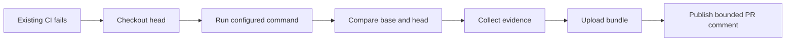

# Causent

Causent investigates failed CI runs.

It checks out the failing revision, runs the configured command, compares the
head with a base revision, records bounded evidence, and produces a replayable
diagnosis bundle. It does not claim a root cause when the failure cannot be
reproduced or the evidence is insufficient.

Repair is experimental and opt-in. Candidate patches are applied and tested
only in disposable workspaces. Causent does not silently modify a pull request.

## Example diagnosis

A Causent PR comment should answer more than “this file changed”:

```text
Causent diagnosis

Classification: real_regression
Confidence: 85%
Command: go test ./...

Reproduction: head 3/3 attempts failed; base 3/3 attempts passed
Observed failure: TestSelfDiagnosisIntentionalFailure
Likely changed file: internal/diagnosis/self_failure_test.go
Candidate commit: ae39d70 — test: add temporary self-diagnosis failure

The full bounded evidence is available in the workflow artifact.
```

The classification and localization are evidence-backed. They are not the same
as experimentally verified causality.

## Quick start

Install the Linux amd64 release:

```sh
mkdir -p "$HOME/.local/bin"
curl -fL https://github.com/causent/causent/releases/latest/download/causent_linux_amd64 \
  -o "$HOME/.local/bin/causent"
chmod +x "$HOME/.local/bin/causent"
export PATH="$HOME/.local/bin:$PATH"
causent version
```

Run onboarding in the repository you want to investigate:

```sh
causent init
```

Review the detected command and generated files before committing them.
`causent init` does not silently overwrite existing configuration.

## GitHub Actions

Create `.causent.yml` with the exact command used by the repository's CI:

```yaml
command: go test ./...
attempts: 3
timeout: 10m
```

The generated workflow calls Causent's reusable workflow. A minimal caller
looks like this:

```yaml
name: Causent Diagnosis

on:
  workflow_run:
    workflows: [CI]
    types: [completed]

permissions:
  actions: read
  contents: read
  pull-requests: write

jobs:
  diagnose:
    if: |
      github.event.workflow_run.conclusion == 'failure' &&
      github.event.workflow_run.head_repository.full_name == github.repository
    uses: causent/causent/.github/workflows/ci-diagnose.yml@v1
    with:
      run_id: ${{ github.event.workflow_run.id }}
      head_sha: ${{ github.event.workflow_run.head_sha }}
      base_sha: ${{ github.event.workflow_run.pull_requests[0].base.sha }}
```

Change `CI` to the name of the existing test workflow. The diagnosis job has
read-only repository permissions and no model secrets. Publication is separate.
Fork pull requests are skipped by this example because their code is untrusted.



## What Causent actually proves

The diagnosis contract separates:

- observed facts;
- evidence supporting each claim;
- inferred cause;
- confidence;
- alternative explanations;
- missing information.

The normal pipeline is:

1. Reproduce the configured command on the head revision.
2. Repeat it to identify stable, flaky, or non-reproducible failures.
3. Compare the head with the configured base revision when available.
4. Localize history changes.
5. Record evidence and write a checksummed bundle.

If `--good` is supplied, Causent runs `git bisect` with the configured command.
Without `--good`, it performs a bounded walk through recent history and reports
the first failing revision found by that walk. The walk is a localization hint,
not proof of causality.

## Repeated reproduction and replay checks

Causent does not currently implement true Deterministic Simulation Testing
(DST). It does not control application time, randomness, scheduling, network,
disk, or external event streams.

Its current capability is repeated reproduction and replay checks:

- run the same command several times;
- record exit codes, timeouts, digests, and bounded output;
- compare base and head outcomes;
- persist controlled experiment outcomes;
- verify bundle checksums;
- rerun a recorded command and compare its classification.

Replay checks reproducibility. They do not rerun localization or prove the
original root cause. A future deterministic-simulation adapter could consume a
project's seed and replay format, then shrink a failing seed or fault schedule.

```sh
causent replay .causent/bundles/<timestamp>
```

## Optional model-assisted repair

Diagnosis is the default and does not require a model. Repair is explicit:

```yaml
repair:
  max_attempts: 2
```

Configure a local or hosted Causent gateway, then run:

```sh
export CAUSENT_MODEL_PROVIDER=gateway
export CAUSENT_GATEWAY_ENDPOINT=http://127.0.0.1:8787
export CAUSENT_MODEL=your-model

causent repair --repo . --command "go test ./..." --max-attempts 2
```

For each attempt, Causent generates a structured candidate, validates its file
targets, applies it in a disposable workspace, and runs verification. If it
fails, bounded verification output is sent back for the next candidate. A
passing test verifies the reproduced behavior; it does not prove a universal
fix or root-cause certainty.

GitHub Actions currently runs deterministic diagnosis only. Model-enabled
repair requires a separate trusted workflow because model credentials must not
be exposed to jobs that execute untrusted pull-request code.

## Evaluation

The evaluation harness is the main way to measure whether Causent works beyond
seeded self-tests. Cases should pin:

| Field | Purpose |
| --- | --- |
| Repository and commit | Reproducible source state |
| Base revision | Known-good comparison |
| Failing command and logs | Original failure evidence |
| Expected classification | Deterministic result check |
| Root cause and supporting evidence | Diagnosis correctness check |
| Reproduction result | Whether the failure can be recreated |

The harness compares deterministic, model-assisted, and evidence-guided modes
using the same cases. It measures reproduction, classification, evidence
correctness, patch verification, execution time, unsupported claims, and model
cost. A small fixture set is not a general accuracy claim.

## Supported environments

| Environment | Detection evidence | Limitation |
| --- | --- | --- |
| Go | `go.mod` | The test command must still be configured |
| Node.js | `package.json` and lockfiles | Scripts, services, and matrices may need review |
| Python | `pyproject.toml` or `requirements.txt` | Dependency and test setup is repository-specific |
| Rust | `Cargo.toml` | Toolchain and native dependencies may be required |
| Bazel | `MODULE.bazel`, `WORKSPACE`, or `.bazelversion` | Commands and flags must be explicit |

Manifest detection is evidence of project technology, not proof of the correct
CI command or complete runtime environment.

## Security and limits

- Diagnosis and patch verification use isolated workspaces.
- Docker execution can use no network, a read-only container root, dropped
  capabilities, resource limits, bounded output, and a writable workspace.
- Environment variables and original logs are filtered and bounded.
- Secrets are not passed to the untrusted diagnosis job.
- A PR comment is not permission to modify the PR branch.
- Local execution is not a strong security boundary; use Docker for untrusted
  code when the environment supports it.

## Further documentation

- [Installation and troubleshooting](docs/installation.md)
- [CI integration](docs/ci-integration.md)
- [Supported environments](docs/supported-environments.md)
- [Diagnosis evaluation](docs/diagnosis-evaluation.md)
- [External validation](docs/external-validation.md)
- [Gateway, persistence, SSE, and MCP architecture](docs/runtime-architecture.md)

## Build from source

```sh
git clone https://github.com/causent/causent.git
cd causent
go test ./...
go build -o "$HOME/.local/bin/causent" ./cmd/causent
```

## License

Apache License 2.0. See [LICENSE](LICENSE).
