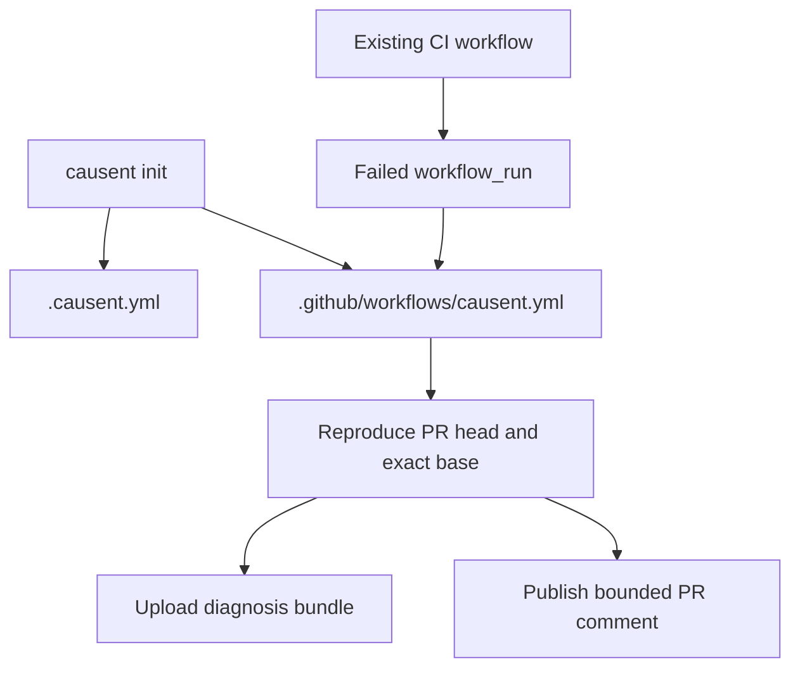

# Causent

Causent diagnoses failed CI runs.

It checks out the failing revision in an isolated workspace, runs the failing command, compares the result with a base revision when one is available, and writes a replayable evidence bundle. An optional model can propose hypotheses from the collected evidence. The deterministic diagnosis remains the source of the classification.

Repair is experimental. Proposed patches are applied and tested in a disposable workspace before they are reported as verified.

## Use Causent in GitHub Actions

Create `.causent.yml` in the repository root:

```yaml
command: go test ./...
attempts: 3
timeout: 10m
```

`command` must be the exact command used by CI. Causent does not invent a command from a manifest alone.

Create `.github/workflows/causent.yml`:

```yaml
name: Causent

on:
  workflow_run:
    workflows: [CI]
    types: [completed]

permissions:
  actions: read
  contents: read
  pull-requests: write

jobs:
  diagnose:
    if: |
      github.event.workflow_run.conclusion == 'failure' &&
      github.event.workflow_run.head_repository.full_name == github.repository
    uses: causent/causent/.github/workflows/ci-diagnose.yml@v1
    with:
      run_id: ${{ github.event.workflow_run.id }}
      head_sha: ${{ github.event.workflow_run.head_sha }}
      base_sha: ${{ github.event.workflow_run.pull_requests[0].base.sha }}
```

Change `CI` to the name of the existing test workflow.



The diagnosis job has read-only repository permissions and no model secrets. Publication is separate. Fork pull requests are skipped because their code is untrusted.

## Install the local CLI

Users do not need to clone this repository. Install the Linux amd64 release:

```sh
mkdir -p "$HOME/.local/bin"
curl -fL https://github.com/causent/causent/releases/latest/download/causent_linux_amd64 \
  -o "$HOME/.local/bin/causent"
chmod +x "$HOME/.local/bin/causent"
export PATH="$HOME/.local/bin:$PATH"
causent version
```

Then run this inside your own repository:

```sh
causent init
```

`causent init` detects manifests, package managers, workflows, runtime versions, and test commands. It asks before replacing existing files. Use `causent init --yes` in automation, then review the result.

The workflow uses the stable major reference `@v1`. Users do not need to
choose a binary version or tag. Causent maintains the release behind that
workflow reference.

Repositories that require reproducible dependency updates can replace `@v1`
with a specific Causent release tag after checking the release notes. The
reusable workflow downloads the matching `causent_linux_amd64` binary.

## Optional model-assisted repair

Diagnosis is the default path. It is deterministic and does not modify the
repository. Repair is a separate, opt-in workflow for testing a candidate
patch in an isolated temporary workspace.

Repair does not commit to the current branch or silently change a pull
request. It proposes a patch, applies it to a disposable copy, runs the
configured failing command, and reports whether verification passed. If the
candidate fails, the configured bounded retry loop sends the verification
feedback to the model for another candidate.

Set the optional retry limit in `.causent.yml`:

```yaml
command: go test ./...

repair:
  max_attempts: 2
```

Then configure a model provider. For a local Causent gateway:

```sh
export CAUSENT_MODEL_PROVIDER=gateway
export CAUSENT_GATEWAY_ENDPOINT=http://127.0.0.1:8787
export CAUSENT_MODEL=your-model
```

Run repair explicitly:

```sh
causent repair --repo . --command "go test ./..." --max-attempts 2
```

The command can read `command` and `repair.max_attempts` from `.causent.yml`:

```sh
causent repair --repo .
```

The result reports one of these outcomes:

- `passed`: the candidate patch applied and the configured test passed in the isolated workspace.
- `failed`: the candidate applied but verification still failed.
- `inconclusive`: the patch could not be safely applied or verification could not complete.

A passing test verifies the reproduced behavior. It does not prove that the
patch is universally correct or that the exact root cause is proven. Review
the diff before applying it with `git apply`.

GitHub Actions currently runs deterministic diagnosis only. This keeps model
credentials away from jobs that execute untrusted pull request code. A model-
enabled repair workflow must be explicitly designed with a trusted, separate
job before it is enabled in CI.

## Local diagnosis

```sh
causent diagnose --repo . --command "go test ./..." --attempts 3
```

Compare the current revision with a base:

```sh
causent diagnose --repo . --base origin/main --command "go test ./..."
```

If the command does not fail or never executes, Causent refuses to claim a diagnosis.

## Report contents

- Reproduction results and bounded output.
- Deterministic classification.
- Optional head/base comparison.
- Git history localization when possible.
- Original CI log evidence from the GitHub workflow.
- A checksummed replay bundle.
- Optional model hypotheses with validated evidence references.

The model does not control classification, execute commands, or edit the repository.

## Deterministic Simulation Testing (DST)

Causent's normal diagnosis path is Deterministic Simulation Testing (DST). DST
runs the same configured command repeatedly in a controlled workspace, records exit
codes, timeouts, output digests, and bounded excerpts, and compares the head
with a known-good base when one is available.

The current implementation provides these DST capabilities:

- repeated reproduction attempts to separate stable failures from flaky ones;
- head-versus-base comparison;
- bounded history walking or an explicitly supplied known-good revision;
- controlled diagnostic experiments with persisted outcomes;
- checksummed evidence and replayable bundles;
- replay verification that reruns the recorded command and checks whether the
  original classification still holds.

DST is the reproducibility and evidence layer; it does not automatically prove
causality. Replay does not rerun localization or claim that the original root
cause was proven. It answers a narrower question: whether the recorded failure
and classification can be reproduced again.

```sh
causent replay .causent/bundles/<timestamp>
```

## Persistence, events, and SSE

Investigations can persist their lifecycle, evidence, experiments, patches,
and verification reports in SQLite. The HTTP gateway exposes an
OpenAI-compatible model endpoint and an investigation event stream.

Start the gateway with a configured provider:

```sh
CAUSENT_GATEWAY_PROVIDER=ollama \
CAUSENT_GATEWAY_MODEL=qwen2.5:7b \
go run ./cmd/gateway
```

Available gateway endpoints include:

- `GET /health` — gateway and provider status;
- `GET /v1/models` — configured model metadata;
- `POST /v1/chat/completions` — bounded non-streaming model requests;
- `GET /v1/investigations/<id>/events` — Server-Sent Events for investigation
  lifecycle updates.

The SSE stream sends persisted investigation events, supports the
`Last-Event-ID` header for reconnecting from a cursor, and sends keepalive
heartbeats. A gateway started without a SQLite store can serve model requests
but cannot provide investigation SSE events.

## MCP integration

Causent also includes a bounded stdio MCP server for local agent clients. It
requires an explicitly authorized repository root and restricts executable
commands, paths, timeouts, request sizes, response sizes, and environment
variables.

Build and start it for a repository:

```sh
go build -o causent-mcp ./cmd/mcp-server
./causent-mcp --root "$PWD" --db "$PWD/.causent/mcp.db"
```

The MCP tools cover investigation start and cancellation, investigation and
evidence lookup, hypotheses, experiments, patches, verification reports, and
final reports. MCP access is local and authorized-root based; it is not a
replacement for the GitHub Actions integration.

## Evaluation harness

The repository contains a fixture-backed evaluation harness for comparing
deterministic and model-assisted strategies against pinned benchmark cases.
Each case records its repository, buggy and known-good revisions, reproduction
command, expected failure, and root-cause ground truth.

The harness reports completion, reproduction, classification, patch
verification, root-cause, execution-time, and model-call metrics. It is an
evaluation tool, not runtime behavior and should not be used to claim general
accuracy from a small fixture set.

## Supported environments

| Environment | Detection | Runner setup |
| --- | --- | --- |
| Go | `go.mod` | Configured automatically in the reusable workflow |
| Node.js | `package.json` and lockfiles | Repository provides Node setup |
| Python | `pyproject.toml` or `requirements.txt` | Repository provides Python setup |
| Rust | `Cargo.toml` | Repository provides Rust setup |
| Bazel | `MODULE.bazel`, `WORKSPACE`, or `.bazelversion` | Explicit command and flags required |

Manifest detection does not prove that dependencies, services, native libraries, or CI matrix settings are available.

## Security and limits

- Diagnosis runs in an isolated workspace.
- Docker execution uses a read-only root filesystem, no network, dropped capabilities, bounded resources, and a writable workspace only.
- Environment variables are filtered.
- Output and original CI logs are bounded.
- Secrets are not passed to the untrusted diagnosis job.
- Pull request publication is separate from diagnosis.

The current release workflow targets Linux amd64. GitHub Actions is the primary integration. External repositories and maintainer-confirmed production cases are still required before broad reliability claims.

## Build from source

For contributors or users who need a local build:

```sh
git clone https://github.com/causent/causent.git
cd causent
go test ./...
go build -o "$HOME/.local/bin/causent" ./cmd/causent
```

## Development

```sh
go test ./...
```

Further documentation:

- [Installation and troubleshooting](docs/installation.md)
- [CI integration](docs/ci-integration.md)
- [Supported environments](docs/supported-environments.md)
- [Diagnosis evaluation](docs/diagnosis-evaluation.md)
- [External validation](docs/external-validation.md)

## License

Apache License 2.0. See [LICENSE](LICENSE).
